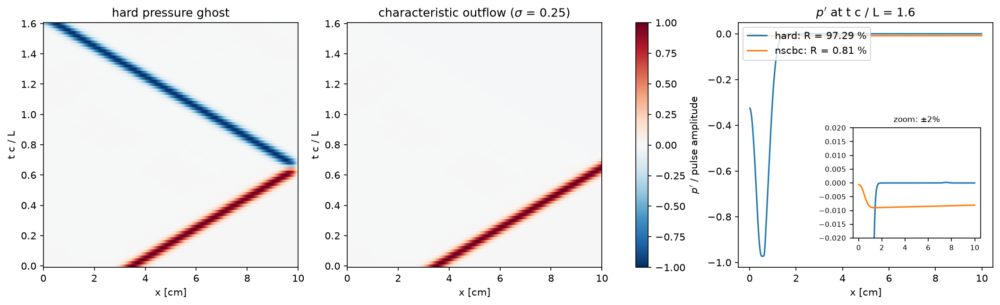

# Rung 1 — why a characteristic outflow

**Question:** what goes wrong when an outflow simply imposes the ambient
pressure, and what does the characteristic boundary do instead?

**Case:** `Exec/RegTests/NSCBC-Acoustic`, 2-D, 400 × 8 cells, 10 cm long.
A right-running acoustic pulse (0.1% of 1 atm) leaves a quiescent duct:
wall at `x = 0`, outflow at `x = 10 cm`, periodic in `y`.
**Cost:** about a minute on 4 ranks.

```sh
./run.sh            # builds the case, runs both variants into runs/
python plot.py      # writes outflow_pulse.png, prints R against the reference
```



## What you are looking at

The left two panels are x–t diagrams of the pressure perturbation, averaged
across the duct. The pulse runs right at the sound speed and reaches the
outflow at `t c / L ≈ 0.65`.

* **Hard pressure ghost** (`pelec.bc_nscbc = 0`; the case's `bcnormal`
  writes the ambient density and pressure into the ghost cells). The pulse
  comes back **inverted and almost whole**: R = 97%. Fixing the pressure at
  the boundary forces the incoming wave to cancel the outgoing one's pressure,
  and a wave that cancels a pressure perturbation reflects it with
  coefficient −1.
* **Characteristic outflow** (`pelec.bc_nscbc = 1`, σ = 0.25). The ghost
  cells continue the *outgoing* characteristic from the interior and only the
  *incoming* one is modelled — as a gentle relaxation toward the target
  pressure. The pulse leaves; what remains (inset, ±2% scale) is a small wave
  near the wall and a uniform −0.9% offset. Both are the relaxation's own
  doing: while the pulse crossed the boundary the relaxation saw an
  overpressure and pulled it toward the target, launching a weak incoming
  wave. The offset decays at the relaxation rate. Rung 2 is about exactly
  that trade between letting waves out and holding the mean.

`R` is the largest residual in the upstream half of the domain at
`t c / L = 1.6`, measured from that half's median (so a uniform offset is not
counted as a wave), divided by the pulse amplitude.

| outflow | R (reference) |
|---|---|
| hard pressure ghost | 97.3 % |
| characteristic, σ = 0.25 | 0.81 % |

## Things to try

* `pelec.bc_nscbc_sigma = 0` in the `nscbc` variant: R = 0.00% and no
  offset — a perfectly transparent outflow. The price is that nothing holds
  the mean pressure at the target; rung 2 shows what that costs.
* `pelec.bc_nscbc_order = 1` (first-order extrapolation of the outgoing
  invariant): R = 0.79%, no better or worse for a smooth pulse. The order
  matters for structure crossing the boundary, not for acoustics (the
  `NSCBC-FlameOutflow` case README measures it on a flame).

To rerun a variant after changing it, delete its directory under `runs/`.
