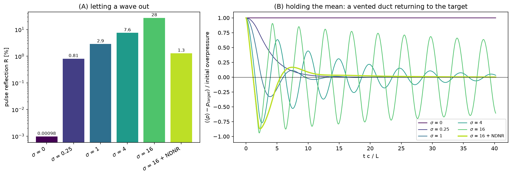

# Rung 2 — σ, the outflow dial

**Question:** how hard should an outflow pull its pressure toward the target?

**Case:** the rung-1 duct (wall at `x = 0`, outflow at `x = L = 10 cm`), run
two ways for σ = 0, 0.25, 1, 4, 16, and σ = 16 with the NDNR register:

* **(A)** the rung-1 pulse: how much of a wave the outflow reflects.
* **(B)** a uniform 0.1% overpressure at rest: how the outflow returns the
  domain's *mean* pressure to the target, over 40 acoustic transits.

**Cost:** about five minutes on 4 ranks.

```sh
./run.sh
python3 plot.py     # writes outflow_sigma.png, prints both numbers per variant
```



## What σ is

The incoming wave at an outflow is modelled as a relaxation of the boundary
pressure toward the target at the rate

    K = σ (1 − M²) c / L,      τ_relax / τ_acoustic = 1 / (σ (1 − M²)),

with `L` the domain length normal to the face. σ = 0.25 pulls the boundary
back over about four acoustic transits; σ = 16 within a sixteenth of one.

## What you are looking at

| σ | R [%] | (B): largest mean deviation after 20 L/c |
|---|---|---|
| 0 | 0.001 | 1.0 — never returns |
| 0.25 | 0.81 | 6 × 10⁻⁴ |
| 1 | 2.9 | 2 × 10⁻³ |
| 4 | 7.6 | 0.21 — still ringing |
| 16 | 28 | 0.74 — barely damped |
| 16 + NDNR | 0.92 | 1 × 10⁻⁴ |

* **σ = 0 is perfectly transparent and perfectly unanchored.** The pulse
  leaves without a trace, but the overpressure in (B) stays forever: nothing
  tells the domain what the outside pressure is.
* **Raising σ anchors faster and reflects more.** Each step up in σ buys a
  faster return of the mean at the price of a larger reflection, and from
  σ ≈ 4 the duct starts ringing: a stiff outflow is close to a pressure
  node, so the duct's quarter-wave mode bounces between it and the wall
  (period 4 L/c). At σ = 16 the boundary is a hard wall for acoustics in all
  but name.
* **σ = 0.25 (the default) is the sweet spot for this kind of problem:**
  under 1% reflection, and the mean within 1% of the target after 13
  transits, with no overshoot at all.
* **NDNR (`pelec.bc_nscbc_ndnr = 1`) breaks the trade.** The register keeps a
  slow average of the outgoing wave at each boundary point and the relaxation
  ignores the wave currently leaving, so even σ = 16 reflects only 0.9% and
  the ringing is gone: one swing below the target (−0.99), a +0.01
  overshoot, and within 1% after 9 transits — sooner than σ = 0.25 (13),
  though through a full swing that σ = 0.25 never makes. Its use is when the
  mean must be held tightly while sound keeps leaving — a forced or ringing
  duct. The register reads the outgoing wave from the *deviations* of
  `u` and `p`, so a hot front or a flame crossing the outflow does not fool
  it (rung 6). Judge an NDNR run over many transits: the register needs a few
  of its time constants (6 L/c) to form.

## Rules of thumb

* Start at σ = 0.25. Check two time scales: τ_relax = L / (σ c) must be well
  above an acoustic transit (or waves reflect) and well below the run time
  (or the mean drifts). PeleC prints τ_relax in transits at startup.
* If the mean must be held tightly, raise σ **with** `bc_nscbc_ndnr = 1`,
  not instead of it.
* A boundary that rings or reflects at every reasonable σ is usually sitting
  on something it cannot handle — rungs 5–7.

## Things to try

* Halve the domain (`geometry.prob_hi = 5.0 0.5`, `amr.n_cell = 200 8`) at
  σ = 0.25. The relaxation rate scales as c / L, so the prediction is a
  return twice as fast in physical time and in the same number of transits;
  check it against the curve above.
