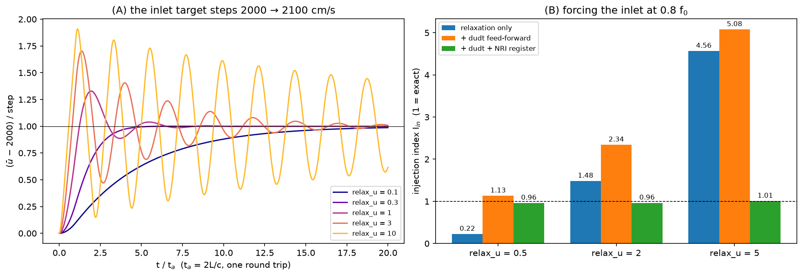

# Rung 3 — the subsonic inflow

**Questions:** how stiffly should an inlet hold its velocity, and how do you
inject a signal (forcing) through it?

**Case:** `Exec/RegTests/NSCBC-Acoustic` in duct mode (`nscbc-acoustic-duct.inp`),
2-D, 200 × 8 cells, `L` = 10 cm. A characteristic **inflow** at `x = 0` feeds a
2000 cm/s stream; the far end imposes the ambient pressure, so it reflects
everything. That reflecting far end is deliberate: it sends every wave back to
the inlet, so what you see is the inlet's own behaviour.
**Cost:** about three minutes on 4 ranks.

```sh
./run.sh
python3 plot.py     # writes inflow.png, prints both measures per variant
```



## What an inflow specifies

At a subsonic inflow only one characteristic leaves the domain (the
upstream-running acoustic wave), so everything else is specified, each in
its own way:

| quantity | how | key |
|---|---|---|
| normal velocity | relaxed, rate `K = relax_u (1 − M²) c / L` | `pelec.bc_nscbc_relax_u` (2.0) |
| temperature, tangential velocity | relaxed, rate `relax_t c / L` | `pelec.bc_nscbc_relax_t` (0.2) |
| composition, passive scalars | imposed exactly | the hook's `Target` |

`relax_u` is the inlet's σ: the same trade between holding the target and
letting waves through.

## (A) A step in the inlet target

The duct starts at 2000 cm/s and the inlet asks for 2100 from `t = 0`. The
left panel is the mean velocity in the duct; `t_a = 2L/c` is one acoustic
round trip. Time to settle within 1% of the step:

| relax_u | 0.1 | 0.3 | 1 | 3 | 10 |
|---|---|---|---|---|---|
| t_conv / t_a | > 20 | 4.7 | 7.6 | 20 | > 20 |

* **Too soft (0.1):** no overshoot, but the inlet barely pulls; after 20
  round trips the flow is still short of the target.
* **Too stiff (3, 10):** the inlet is close to a fixed velocity, which
  reflects acoustic waves like a wall. Between it and the reflecting far end
  the duct rings at its quarter-wave frequency, and at `relax_u = 10` the
  flow overshoots by 90% and is still swinging after 20 round trips.
* **In between (0.3–1):** settled in 5–8 round trips.

## (B) Forcing the inlet

The inlet's target now oscillates, `u0 + A sin(2π f t)` with `A` = 34.7 cm/s
and `f = 0.8 f0` (`f0` = 865 Hz, the duct's quarter-wave frequency). The
measure is the injection index `I_in`: the amplitude of the wave that actually
enters the duct, divided by the amplitude of the wave you asked for.

| relax_u | relaxation only | + `dudt` feed-forward | + `dudt` + NRI register |
|---|---|---|---|
| 0.5 | 0.22 | 1.13 | 0.96 |
| 2 | 1.48 | 2.34 | 0.96 |
| 5 | 4.56 | 5.08 | 1.01 |

* **Relaxation alone injects the wrong signal at every stiffness.** A
  relaxation is built to hold a mean; asked to follow a moving target it lags
  (soft) or, near a resonance, overdrives (stiff).
* **Feed-forward alone is not enough.** `Target::dudt` — the analytic time
  derivative of the target, returned by your `bcnormal_nscbc` hook — puts the
  requested wave into the incoming characteristic directly, but the
  relaxation still fights the waves coming back from the domain.
* **Feed-forward plus `pelec.bc_nscbc_nri = 1` injects what you asked for, at
  any `relax_u`.** The NRI register stops the relaxation from reacting to the
  outgoing wave, so `relax_u` only holds the mean.

Measure an inlet by the wave it injects, not by the velocity you see at it.
The inlet velocity is the injected wave *plus* whatever the domain sends
back: with exact injection here it oscillates at only 0.61 of `A`, which is
the duct's standing-wave response, not a boundary error.

## Rules of thumb

* Unforced inlet, domain closed by an absorbing (characteristic) outflow: the
  default `relax_u = 2` is fine — it reflects under 5% of an incident wave
  (BCs chapter). If the far end reflects — a closed chamber, a hard outlet —
  lower it toward 0.3–1.
* `relax_u` much above 10 is a fixed velocity in disguise: it reflects like a
  wall, and the reflected waves have nowhere to go.
* To force an inlet, supply `dudt` in the hook **and** set
  `pelec.bc_nscbc_nri = 1`; then choose `relax_u` only for how tightly the
  mean must be held.

## Things to try

* Force on resonance: `prob.force_freq=865.1` (with `stop_time=8.08e-3
  amr.plot_per=4.816e-5`). At `relax_u = 2` relaxation alone injects 0.63 of
  the wave and feed-forward + NRI 0.92 — yet the inlet velocity hardly moves
  in either case (0.8% and 0.5% of `A`): on resonance the inlet sits at a
  velocity node of the duct, so the wave goes in while the velocity there
  stays put.
