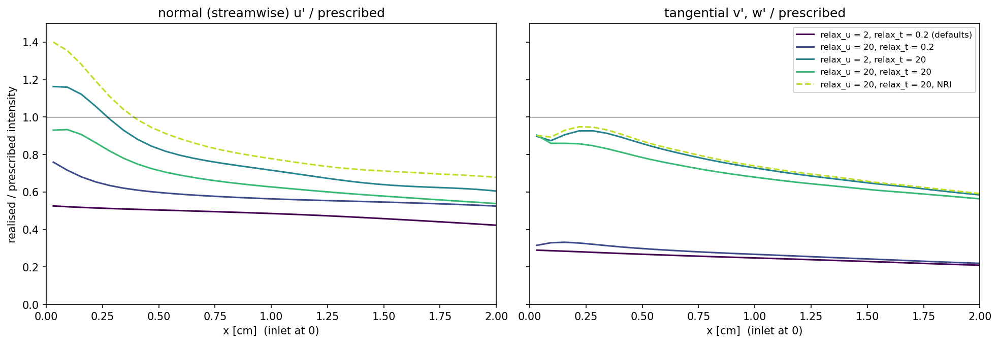

# Rung 4 — a turbulent inflow through the characteristic inlet

**Question:** how much of a prescribed inflow turbulence actually gets into
the domain through a characteristic inlet, and which settings control it?

**Case:** `Exec/RegTests/NSCBC-Acoustic` in duct mode, **3-D**: a 4 × 1 × 1 cm
duct, periodic across, 64 × 16 × 16 cells, mean flow 2000 cm/s (M ≈ 0.06).
The inlet carries PelePhysics TurbInflow fluctuations from a synthetic
homogeneous isotropic turbulence box: u' = 100 cm/s (5%), eddies about 0.5 cm.
**Cost:** about eight minutes on 4 ranks, including the 3-D build.

```sh
./run.sh            # makes the turbulence box, builds 3-D, runs five variants
python plot.py      # writes turbulent_inflow.png, prints the inlet fractions
```



## Feeding TurbInflow through the characteristic inlet

TurbInflow is configured exactly as for any PeleC inlet (`duct3d.inp`), and
the fluctuations reach your `bcnormal_nscbc` hook in `turb_fluc`, just as they
reach `bcnormal`. The hook decides what to do with them; here it adds them to
the mean inflow target (`prob.H`):

```cpp
t.type = pc_nscbc::Type::inflow;
t.u[0] = prob_parm.u0 + forcing;
for (int d = 0; d < AMREX_SPACEDIM; d++) {
  t.u[d] += turb_fluc[d];
}
```

Two inputs to get right:

* `turbinflow.<name>.turb_scale_loc` converts *physical lengths into box
  lengths*. The box from `make_hit.py` (or PelePhysics'
  `Support/TurbInflowGenerator`) is 2π long, so mapping it onto 1 cm needs
  `turb_scale_loc = 2π`. Getting this upside down makes the eddies 40 times
  too large: they barely change across a 1 cm duct or over the run, and the
  inlet then appears to swallow nearly all of the turbulence.
* `turb_conv_vel` should be the mean inflow velocity, so the box is swept
  past the inlet at the speed the eddies are carried away.

## What you are looking at

Realised intensity divided by the prescribed one, against distance from the
inlet: streamwise `u'` on the left, tangential `v'`, `w'` on the right,
averaged across the duct and over 1–3 ms. At the first cell:

| inlet settings | normal | tangential |
|---|---|---|
| `relax_u = 2`, `relax_t = 0.2` (defaults) | 0.53 | 0.29 |
| `relax_u = 20`, `relax_t = 0.2` | 0.76 | 0.32 |
| `relax_u = 2`, `relax_t = 20` | 1.16 | 0.90 |
| `relax_u = 20`, `relax_t = 20` | **0.93** | **0.90** |
| `relax_u = 20`, `relax_t = 20`, NRI | 1.40 | 0.90 |

* **The defaults filter a turbulent inflow heavily.** Each component is
  relaxed toward its target at a finite rate — `relax_u c / L` for the
  normal one, `relax_t c / L` for the tangential ones — while an eddy of size
  ℓ passes in a time ℓ / U. Fluctuations faster than the relaxation get
  through only partly: half of `u'` and under a third of `v'`, `w'` here.
* **`relax_t` is the tangential (and temperature) dial, and it can simply be
  made stiff.** Temperature and tangential velocity ride characteristics that
  *enter* at an inflow, so imposing them exactly is well posed; above
  `relax_t ≈ |u| L / (c Δx)` (≈ 4 here) the fill does exactly that.
* **Stiffen both together.** Stiff tangential with a soft normal component
  (third row) injects a velocity field that is not divergence-free at the
  inlet; the pressure responds and the normal fluctuation overshoots near the
  inlet (1.16) before relaxing within about half a duct width. With both stiff the
  inlet passes 0.93 and 0.90.
* **Do not combine NRI with a turbulent inflow.** The register estimates the
  outgoing acoustic wave from `u + p / ρc` at the inlet, and a convected
  eddy's velocity looks like an outgoing wave to it; half of each eddy is fed
  back into the target and the normal fluctuation is amplified (1.40). NRI is
  for injecting acoustic signals (rung 3); PeleC warns when it is enabled
  together with TurbInflow.
* The decay downstream is the same in every run: the turbulence decays and
  the 0.5 cm eddies are only about eight cells across. It is not the boundary.

## The price, and the rules of thumb

A stiff `relax_u` reflects acoustic waves arriving at the inlet: the BCs
chapter measures 19% at `relax_u = 10` and 57% at 50. A turbulent inlet
therefore trades turbulence fidelity against acoustic transparency.

* To pass turbulence faithfully: `relax_t` ≳ 4 (exact), and `relax_u` large
  enough that `relax_u c / L` exceeds the eddy frequency `2π U / ℓ` — about
  `relax_u ≳ 2π M L / ℓ`. Long domains and small eddies need stiffer inlets.
* If acoustic waves must leave through the inlet as well, keep `relax_u`
  moderate and raise the prescribed intensity (`turb_scale_vel`) until the
  realised one matches — knowing that the smallest, fastest eddies are cut
  more than the large ones.
* Check what you got: measure the realised intensity a few cells in, as
  `plot.py` does, rather than trusting the prescribed one.
