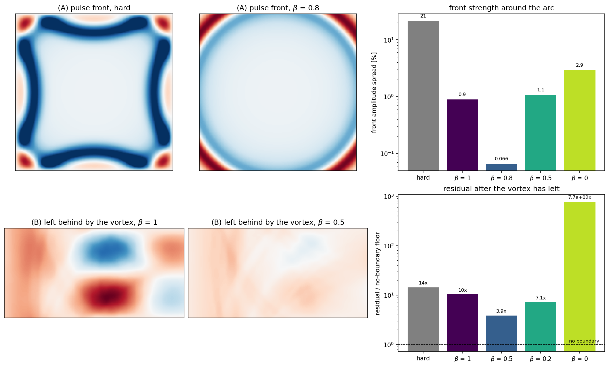

# Rung 5 — oblique waves and vortices: the transverse weight β

**Question:** what happens when a wave meets the boundary at an angle, or a
vortex rather than a sound wave crosses it — and how should β be set?

**Case:** `Exec/RegTests/NSCBC-COVO`, 2-D, two experiments:

* **(A)** a circular pressure pulse in a 10 × 10 cm square whose four faces
  are all characteristic outflows (200 × 200 cells). The front meets the
  faces at every angle from head-on to grazing.
* **(B)** a vortex carried at M = 0.2 from a characteristic inflow to a
  characteristic outflow (10 × 5 cm, 200 × 100 cells, periodic in y), and
  the same vortex in a fully periodic box, which has no boundary at all and
  gives the discretisation floor.

**Cost:** about four minutes on 4 ranks.

```sh
./run.sh
python3 plot.py     # writes transverse.png, prints both measures per variant
```



## What β does

Everything in rungs 1–4 decomposes the flow into waves travelling *normal* to
the boundary. A wave arriving at an angle, or a vortex sliding across the
face, also carries changes *along* the face, and the 1-D decomposition
mistakes part of them for an incoming wave — which the boundary then
"corrects", launching a spurious one. The transverse terms put those
along-the-face changes back into the modelled incoming wave, weighted by
`1 − β`:

| `pelec.bc_nscbc_beta` | meaning |
|---|---|
| 1 (default) | transverse terms off: the 1-D-normal limit |
| 0 | transverse terms fully on |
| between | partly on; for a plane sound wave at angle θ the exact value is `β = 1 − cos θ / (1 + cos θ)`: 0.5 head-on, rising toward 1 at grazing incidence |

## What you are looking at

**(A) The circular pulse**, measured when only the corner-directed part of
the front is left inside the box — the part that has travelled past the faces
at shallow angles. A boundary that is transparent at every angle leaves the
front equally strong all round; the measure is the spread of its strength
around the arc.

| | hard | β = 1 | β = 0.8 | β = 0.5 | β = 0 |
|---|---|---|---|---|---|
| front strength spread | 21% | 0.90% | **0.066%** | 1.1% | 2.9% |

The hard boundary squares the front off and sends lobes back from every face.
The characteristic boundary already does well without transverse terms;
β = 0.8 — the plane-wave formula's value for the shallow angles this arc
crossed at — is another factor of 14.

**(B) The vortex.** A vortex carries almost no sound, so an ideal boundary
lets it leave in silence: whatever pressure is left in the domain afterwards
was made by the boundary. The measure is that leftover pressure (rms), over
the same quantity in the box with no boundary.

| | hard | β = 1 | β = 0.5 | β = 0.2 | β = 0 |
|---|---|---|---|---|---|
| residual / no-boundary floor | 14× | 10× | **3.9×** | 7.1× | unstable (770×) |

* Without transverse terms (β = 1) the characteristic boundary is barely
  better than a hard one for a vortex: the leftover pressure pattern (left
  image) is the boundary reacting to the vortex as if it were sound.
* β = 0.5 removes most of it (right image).
* **Too much correction is catastrophic.** At β = 0 the boundary turns
  supersonic as the vortex crosses and the pressure swings by 70% of ambient.
  The response to β is lopsided: too little costs a factor of a few, too much
  breaks the run.

## Rules of thumb

* Use the transverse terms whenever anything crosses the boundary at an
  angle or rotates through it: vortices, shear layers, a wave arriving
  obliquely. Start at **β = 0.5**.
* Raise β toward 0.8–1 if what leaves is mostly sound arriving at shallow
  angles (a front sweeping along the face).
* Never use β = 0, and avoid the legacy negative setting (β = local Mach
  number, varying point by point): on the vortex it measures 17×, worse than
  no correction at all.
* β is set once for every characteristic face; when in doubt between two
  values, prefer the larger one.

## Things to try

* β = 0.35 on the vortex: 4.2×, against 3.9× at 0.5. The optimum is broad on
  the stable side and a cliff on the other.
