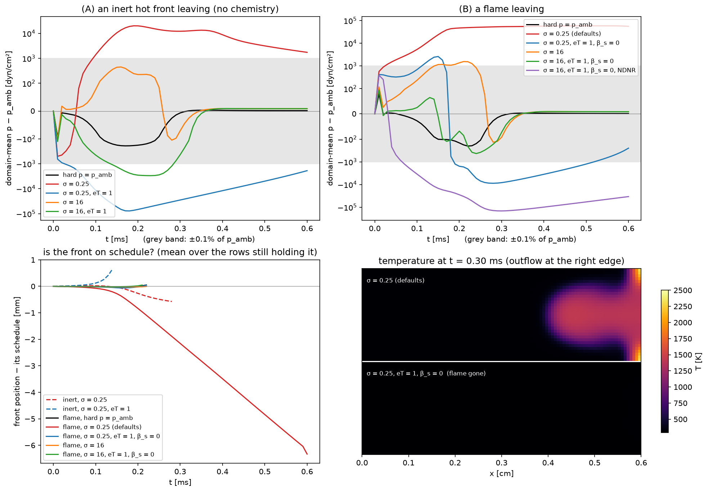

# Rung 6 — what may cross an outflow

**Question:** sound leaves through a characteristic outflow (rungs 1–2), and
so do vortices once the transverse terms are on (rung 5). What about a hot
front, or a flame — what happens when one leaves, and what should be set if
it has to?

**Case:** `Exec/RegTests/NSCBC-FlameOutflow` with `nscbc-flameexit.inp`, 2-D,
0.6 × 0.2 cm, 96 × 32 cells, periodic across. A wrinkled H₂/air flame sheet
(φ = 0.4, S_L = 22.8 cm/s, 298 K → 1423 K) is carried to a characteristic
outflow at x = 0.6 cm by a 912 cm/s stream (40 S_L); the inlet is held hard
so only the outflow is under test. The front reaches the outflow plane at
about 0.1 ms and is gone by 0.23 ms. After that the exact solution is a
uniform fresh stream at ambient pressure, so any pressure left in the domain
was made by the boundary.

* **(A)** the same temperature and composition profile with the chemistry off
  (`pelec.do_react = 0`): only a hot, light, product-filled gas leaves.
* **(B)** the flame.

**Cost:** the heaviest rung but one. The case splits into 12 boxes, so give
it 12 ranks if you have the cores: `NPROCS=12 ./run.sh` runs all eleven
variants in about 50 minutes, build included (each flame run about 6
minutes, the blocked one 11, each inert run under 2). On the default 4 ranks
expect roughly three times that.

```sh
./run.sh
python3 plot.py     # writes crossing.png, prints the three measures per run
```



## Why a front is not a wave

A characteristic outflow relaxes toward a uniform, source-free stream at the
target pressure: that is the state the relaxation `K (p − p_target)` treats
as finished. Sound passes because it fits that picture — it is a wave the
boundary can recognise and let out. A front does not fit. Across a flame the
gas expands as it burns, and across an inert hot front heat still conducts
from the hot side into the cold one; both are *dilatation*, a velocity jump
the stream must carry out through the boundary. The bare relaxation has no
term for it, so whatever the front pushes integrates into the domain's mean
pressure until `K` drains it — an excursion of order `1/σ`.

The settings that address it:

| key | default | what it does for a crossing front |
|---|---|---|
| `pelec.bc_nscbc_sigma` | 0.25 | stiffer anchoring: a smaller excursion, drained sooner, at the price of reflecting sound (rung 2: 27.5% at σ = 16) |
| `pelec.bc_nscbc_extrap_temperature` (eT) | 0 | extrapolates temperature into the ghost cells, so the conductive flux at the face is the interior one |
| `pelec.bc_nscbc_beta_s` | 1 | at 0, adds the chemical heat release in the boundary cells to the incoming wave, so a burning boundary cell is not mistaken for a pressure error |
| `pelec.bc_nscbc_extrap_material` | 0 | for fronts that *sit* on the boundary; off for any front that leaves (it over-vents the transit; case README) |

The measures: the domain-mean pressure excursion (largest during the run, and
what is left at 0.6 ms, long after the front has gone), and whether the front
keeps its schedule `x(0) + V t` (`V = U` inert, `U − S_L` burning).

## (A) An inert hot front

| outflow | largest excursion | left at 0.6 ms | front |
|---|---|---|---|
| hard `p = p_amb` | −192 | +1.2 | on schedule |
| σ = 0.25 | **+20,067** (2.0% of ambient) | +1,738 | held back, leaves 0.08 ms late |
| σ = 0.25, eT = 1 | **−77,562** (7.7%) | −1,895 | dragged out early; the stream triples |
| σ = 16 | +451 | +8.6 | on schedule |
| σ = 16, eT = 1 | −2,997 | +8.6 | on schedule |

(dyn/cm²; ambient is 1.013 × 10⁶, and the grey band in the figure is ±0.1%.)

* **The hard outflow does best.** With no sound to let out, holding
  `p = p_amb` at the face is what a low-Mach exit really looks like, and the
  front leaves undisturbed.
* **At the default σ the front is not free to leave.** The excursion reaches
  2%, the front leaves late, and the domain is still 0.17% high at 0.6 ms,
  0.3 ms after the front has gone.
* **The temperature closure overcorrects an inert front:** the excursion
  flips sign and grows fourfold, the outflow over-vents, the stream accelerates to three times its speed,
  and the front is dragged out ahead of schedule. eT = 1 is half of the flame
  recipe below; the inert run shows it is not, on its own, a fix for any
  front crossing.
* **σ = 16 holds either closure to a few hundred to a few thousand dyn/cm²**,
  and the domain is back at ambient within 0.15 ms of the exit.

## (B) A flame

| outflow | largest excursion | left at 0.6 ms | front |
|---|---|---|---|
| hard `p = p_amb` | −203 | +1.2 | on schedule |
| **σ = 0.25 (all defaults)** | **+58,615** (5.8%) | +55,581 | **blocked**, then pushed back upstream |
| σ = 0.25, eT = 1, β_s = 0 | −8,818 (0.9%) | −250 | on schedule |
| σ = 16 | +1,561 | +8.5 | on schedule |
| σ = 16, eT = 1, β_s = 0 | −432 | +8.5 | on schedule |
| σ = 16, eT = 1, β_s = 0, NDNR | −1,062 | −13.7 | on schedule |

* **With all defaults the flame never leaves.** Heat release in the boundary
  cells is sustained dilatation; the relaxation has nowhere to put it, and at
  σ = 0.25 the overpressure stalls the stream at the outflow and turns it
  around: the fallback report counts tens of thousands of reversed ghost
  fills per report. Burnt gas is drawn back in, the flame is pushed upstream
  (lower left), and the boundary cells heat to 3,400 K — 2.4 times the adiabatic
  flame temperature, made entirely by the boundary (lower right). The run
  does not crash: it is wrong, quietly.
* **The flame closures, eT = 1 with β_s = 0, let it out on schedule at
  σ = 0.25**, with a 0.9% dip as the burnt gas clears, recovering over the
  next 0.3 ms. β_s = 0 accounts for the chemical heat release in the boundary
  cells; eT = 1 for the conduction. Remember (A): the same eT on an inert
  front is a −7.7% dip, so the pair is calibrated on flames, not a general
  front fix.
* **σ = 16 lets the flame out on its own** (+1,561, 0.15%), and with the
  closures as well it is the quietest characteristic outflow (−432, about
  twice the hard outflow's excursion). It costs the reflection of sound.
* **NDNR does no harm while a front crosses, and no good.** The register
  estimates the outgoing wave from the *deviations* of `u` and `p`, so the
  front's change of impedance (`ρc` halves across it) does not read as a
  wave: with NDNR the σ = 16 closures row reads −1,062 against −432 without.
  Keep it for what it is for — letting sound out of a stiff boundary
  (rung 2).

## What crosses, and what to set

| crossing the outflow | supported? | settings | rung |
|---|---|---|---|
| sound, head-on | yes: under 1% reflected | defaults; `order = 2` | 1, 2 |
| sound at an angle, vortices, shear | yes, with transverse terms | `beta = 0.5` (0.8 for shallow sound) | 5 |
| an inert hot or compositional front | only with stiff anchoring | σ ≈ 16, or a hard outflow if no sound must leave | 6A |
| a flame | yes, with the flame closures or stiff anchoring | eT = 1, β_s = 0; σ = 16 for the quietest exit | 6B |
| flow coming *in* | with the reservoir closure | `backflow_material = 1` and `t.T`, `t.Y` | 7 |

The order to try things in, when a structure must leave and the domain
cannot be longer:

1. **Is there sound that must leave too?** If not — a slow flame in an open
   duct with nothing ringing — a hard `p = p_amb` outflow is simplest and,
   here, the most accurate.
2. **A flame leaves:** `extrap_temperature = 1`, `beta_s = 0`, before it
   arrives. Keep σ = 0.25 if the boundary must stay transparent (a ~1% dip
   as it leaves); raise σ toward 16 if the mean pressure matters more than
   the reflection of sound.
3. **An inert front leaves** (hot products, an exhaust): raise σ toward 16
   and leave `extrap_temperature` at 0, which is better at both σ here.
   Only a hot front followed by cold gas is measured; for other jumps (a
   cold slug, a fuel jet) watch the mean pressure as it leaves.
4. **Never** turn on `extrap_material` where fronts cross.
5. **Check:** the domain-mean pressure while the front leaves, and the
   fallback report. A `flow reversal` count that keeps growing while a front
   is at the outflow means the boundary is pushing it back — the blocked
   flame above.

If none of this is good enough, the boundary is in the wrong place: rung 8.

## Things to try

* `pelec.bc_nscbc_sigma=1` with the closures: the largest excursion is
  −4,710 (case README), between the two σ shown here.
* `pelec.bc_nscbc_extrap_material=1` (the inputs file's own default) with the
  closures: the front is expelled by 0.11 ms with a −0.37 atm excursion —
  why the run script turns it off.
