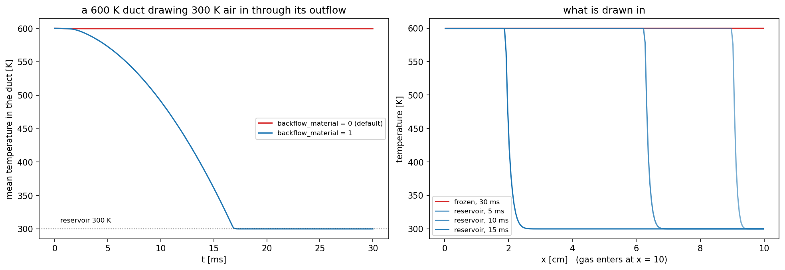

# Rung 7 — flow entering through an outflow

**Question:** what does an outflow do when the flow turns around and comes
*in* — briefly, as when a vented chamber breathes, or for good, as when the
domain is drawing from the reservoir outside?

**Case:** `Exec/RegTests/NSCBC-Acoustic`, 2-D, 200 × 8 cells: a 10 cm duct
whose two ends are both characteristic outflows with ambient air (300 K)
behind them. The duct is filled with gas at 600 K and at rest, and the
`x = 0` target is set 0.5% below ambient (`prob.p_lo_offset`), a sink: a
stream is drawn in through `x = 10 cm` and out through `x = 0`. The face at
`x = 10 cm` stays an *outflow* in the boundary's eyes, but gas comes in
through it — sustained backflow. It is the PeleC version of the 1-D driver's
check C14.
**Cost:** about two minutes on 4 ranks.

```sh
./run.sh
python plot.py      # writes backflow.png, prints the 30 ms state
```



## What an outflow does when the flow reverses

At an outflow the material quantities — temperature, composition, tangential
velocity — ride characteristics that *leave*, so the ghost cells continue
them from the interior. When the flow turns around, those characteristics
*enter*, and something has to say what comes in.

* **Brief reversal** — a chamber ringing down through its vent, a rarefaction
  sucking a little gas back — needs nothing from you. The acoustic part of
  the closure keeps relaxing the pressure on both sides of `u = 0`, the
  material slopes are switched off across a narrow band, and the gas that
  comes back in is the gas that just left. Every reversed fill is counted
  (`flow reversal` in the fallback report).
* **Sustained backflow** is different: the gas coming in is not the gas that
  left, it is the outside. By default the boundary still hands back the
  interior's own material, so the domain draws its own exhaust. Here that
  means it never cools (red): 600 K for good, while a 2900 cm/s stream pours
  in.
* **`pelec.bc_nscbc_backflow_material = 1`** makes firm backflow enter with
  the *reservoir* state your outflow `Target` carries. The duct flushes: a
  cold front marches in from `x = 10 cm` and the whole duct is at the
  reservoir's 300 K after 17 ms (blue).

The switch blends over a band of outward Mach number from 10⁻³ (still the
interior's material) to 10⁻² (fully the reservoir's), so breathing
reversals, which are far slower, never feel it.

## What the hook must provide

`backflow_material` uses the outflow target's temperature, composition and
tangential velocity, which an outflow otherwise never needs. The hook here
(`prob.H`) supplies them:

```cpp
t.type = pc_nscbc::Type::outflow;
t.p = prob_parm.p_amb;
t.T = prob_parm.T_amb;            // the reservoir beyond the face
for (amrex::Real& yv : t.Y) { yv = 0.0; }
t.Y[0] = 1.0;
```

With no `t.T`, the switch does nothing.

## Rules of thumb

* Read the fallback report (`pelec.sum_interval > 0`, or every 100 steps
  with `pelec.v > 0`). A `flow reversal` count that keeps growing means a
  face in sustained backflow — here it counts every ghost fill of the
  `x = 10 cm` face.
* If you know the flow comes in through a face, make that face an **inflow**:
  the inflow closure specifies velocity, temperature and composition properly.
  `backflow_material` is for faces that can go either way — a vent, an open
  side of a jet domain.
* For any face that may see sustained backflow, give its outflow `Target` the
  reservoir's `T`, `Y` (and tangential `u`) and set `backflow_material = 1`.
  It changes nothing while the flow leaves.
