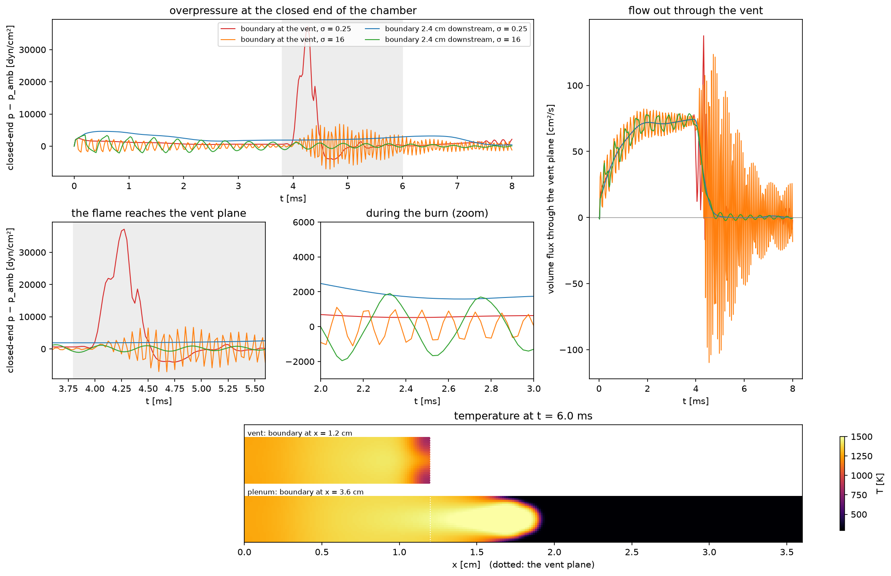

# Rung 8 — when the answer is a longer domain

**Question:** rungs 1–7 choose settings for a boundary that stays where it
is. When is no setting good enough, how can you tell from your own runs, and
what does moving the boundary buy — and not buy?

**Case:** `Exec/RegTests/NSCBC-Chamber`, 2-D: a 1.2 × 0.3 cm chamber of
quiescent H₂/air (φ = 0.4), closed at x = 0, walled top and bottom, open at
x = 1.2 cm. A small half-disc of burnt gas on the closed end ignites it. For
4 ms the flame burns down the chamber and pushes fresh gas out through the
vent, at up to 75 cm²/s; at about 4.0 ms it reaches the vent plane, and the
burnt chamber rings down. The quantity of interest is what an experiment
would record: the pressure at the closed end. Two layouts, each at σ = 0.25
and σ = 16:

* **vent** (`chamber-vent.inp`): the characteristic boundary *is* the vent
  plane, carrying rung 6's flame closures (`extrap_temperature = 1`,
  `beta_s = 0`, `beta = 0.5`).
* **plenum** (`chamber-plenum.inp`): the duct continues to x = 3.6 cm, holding
  air beyond the vent (`prob.charge_end=1.2`), and the same boundary sits at
  its end — three times the cells.

**Cost:** the heaviest rung. On a shared 128-core node each vent run took
30 minutes on 8 ranks and each plenum run 29 minutes on 24; the grids split
into 16 and 48 boxes, so give it ranks (`NPROCS=16 ./run.sh`, or run the
variants side by side).

```sh
./run.sh
python plot.py      # writes longer_domain.png, prints the measures per run
```



## What you are looking at

Top: the closed-end pressure. Middle: the moment the flame reaches the vent
plane, and a stretch of the burn enlarged. Right: the volume flux through the
vent plane (an interior plane in the plenum layout). Bottom: the temperature
at 6 ms.

| layout | σ | closed end during the burn | largest at the end of burn | rings at |
|---|---|---|---|---|
| vent | 0.25 | +595 | **+37,178** (3.7% of ambient) | 2.7 kHz |
| vent | 16 | −15, swinging ±1,100 | +6,874, swinging | 13.8 kHz |
| plenum | 0.25 | +1,817 | +2,886 | no clear ring |
| plenum | 16 | −72, swinging ±1,950 | +1,133 | 2.5 kHz |

(dyn/cm²; "during the burn" is the mean over 2–3.5 ms, "end of burn" the
largest value over 3.8–6 ms.)

### While the flame is inside the chamber, the vent placement is fine

For the first 4 ms only fresh gas and sound cross x = 1.2 — what rungs 1–5
showed a characteristic outflow handles. The flow out of the chamber is the
same in both layouts (73 cm²/s at 3.5 ms at σ = 0.25; 67 and 69 at σ = 16),
for a third of the cells.

### When the flame reaches the vent, it is not

At about 4.0 ms the flame arrives at the vent plane. With the boundary
there, that is rung 6's problem in its hardest form — a flame burning into
the outflow, with a closed chamber behind it — and neither setting does what
the extended duct does:

* **σ = 0.25:** the flow out of the chamber stalls and briefly reverses (the
  vent-plane flux dips below zero), and the closed-end pressure spikes to
  +37,000 — 3.7% of ambient and 13 times anything the extended duct shows.
* **σ = 16:** no stall, but the boundary is now close to a fixed pressure,
  and the burnt chamber rings at its own quarter-wave (13.8 kHz): ±7,000 at
  the closed end, ±100 cm²/s through the vent.
* **Boundary 2.4 cm downstream:** the flame crosses the vent plane as
  ordinary interior physics. The flow out of the chamber falls smoothly to
  zero over 0.4 ms, the same at either σ, and the closed-end pressure has no
  spike.

The flame then burns the nearly 1 cm of charge the chamber pushed out ahead
of it (bottom: hot gas to x ≈ 1.9 cm at 6 ms) — the external burn of a vented
explosion. With the boundary at the vent that charge has already left the
domain; no setting can bring it back.

### The two-σ test

The plainest way to see whether the boundary is part of your answer: run
twice, at σ = 0.25 and σ = 16, and compare. Here, the rms difference between
the two runs' vent-plane flux while the flame reaches the vent (3.8–4.8 ms):

| layout | rms difference |
|---|---|
| boundary at the vent | 67 cm²/s — as large as the flow itself |
| boundary 2.4 cm downstream | 2.5 cm²/s |

A quantity that changes with σ is being set by the boundary, not by your
physics. At the vent even the frequency the chamber rings at belongs to the
boundary: at σ = 0.25 it is 2.7 kHz, of the order of the relaxation rate
σc/2πL (2–2.5 kHz in the burnt chamber) and far from the chamber's own
quarter-wave, which σ = 16 shows at 13.8 kHz.

### What a longer domain does not settle

Now look at the closed-end pressure *during* the burn in the extended duct:
a smooth +1,800 at σ = 0.25, a ±1,950 swing at 2.5 kHz at σ = 16. The far
boundary is still the acoustic end of the system, and the two settings stand
for different ends:

* a soft outflow (small σ) lets sound out and pulls the mean back only
  slowly — as if the duct went on for ever, where pushing flow out raises the
  pressure (by ρc·u, for a truly endless duct) until the relaxation drains it;
* a stiff one (σ = 16) is close to a fixed pressure — an opening into a
  large space — and the 3.6 cm duct rings at its quarter-wave.

Neither is *the* answer. Choose σ for what really lies beyond the domain. A
longer domain takes what crosses the boundary away from the boundary; it
cannot decide what the boundary stands for.

## Rules of thumb

Make the domain longer when:

1. something other than sound and vortices — a flame, a hot or compositional
   front — reaches the boundary during the time you measure, and rung 6's
   best settings cost more than you can accept;
2. the quantity you care about fails the two-σ test;
3. what leaves keeps doing physics outside — here the charge pushed out
   burns beyond the vent; a jet entrains, a plume rises. A boundary can only
   discard it;
4. a face is in sustained backflow whose incoming state you cannot specify
   (rung 7).

How much longer, and how:

* Far enough that nothing but sound and vortices reaches the boundary before
  the measurement ends: the front's own travel plus whatever it pushes ahead
  of it (here about 1 cm of charge; 2.4 cm of duct was ample).
* Fill the extension with what is really there (`prob.charge_end` here: air,
  not more charge).
* Expect σ to act differently: the relaxation rate `K = σ (1 − M²) c / L`
  uses the domain length, so the same σ is three times softer on a domain
  three times longer.
* The extension does not need the flame's resolution: refine the region of
  interest with AMR and leave the extension, and the characteristic face, on
  the coarse level.
* Then choose the far boundary's σ for what it represents, as above.

## Things to try

* Drop `prob.charge_end=1.2` from the plenum runs (the case's default fills
  the duct with charge): through 6 ms the closed-end pressure changes by
  under 400 dyn/cm², because the gas just beyond the vent is pushed-out
  charge either way; after that the duct flame runs into charge instead of
  air and the traces part by up to 2,300.
